# 3XUI-Server-Starter-Pack: Complete Flow & Architecture

---

### End-to-End Architecture Flowchart

```mermaid
flowchart TD
    Start(["User runs bash <(curl -Ls .../install.sh)"]) --> CheckEnv{"Executed via curl pipe?"}
    
    CheckEnv -- "Yes (Missing ./core)" --> Bootstrap["Self-Bootstrap:\nClone repo to /root/3XUI-Server-Starter-Pack\nexec bash install.sh"]
    CheckEnv -- "No (Local directory)" --> RootCheck{"Is Root (EUID==0)?"}
    Bootstrap --> RootCheck
    
    RootCheck -- No --> AbortFail["Abort: Must run as root"]
    RootCheck -- Yes --> InstallDeps["Install system packages:\nnginx, python3, sqlite3, certbot, curl, git"]
    
    InstallDeps --> GatherConfig["Gather Network Config:\nDomain, SSL cert/Let's Encrypt,\nPublic Ports (443, 2083, 2096, 8443)"]
    
    GatherConfig --> InspectNginx["core/nginx_inspector.py:\n1. System Socket Audit (ss -tulpn)\n2. Scan /etc/nginx confs\n3. Read /etc/x-ui/x-ui.db\n4. Build Full Endpoint Inventory"]
    
    InspectNginx --> CheckPreConfig{"3X-UI + Nginx already\nintegrated together?"}
    
    CheckPreConfig -- "Yes (Panel / Inbounds found)" --> PromptMode{"User selects mode:"}
    PromptMode -- "1. Update / Complete" --> ModeComplete["Preserve working panel & inbounds;\nFlag missing inbounds & sub proxy for addition"]
    PromptMode -- "2. Exhaustive Conflict Resolver" --> ModeRuleByRule["Check EVERY port & path in inventory"]
    PromptMode -- "3. Overwrite All" --> ModeOverwrite["Backup all to /etc/nginx/backup_<ts>/;\nFull clean replacement"]
    
    CheckPreConfig -- "No (Fresh or Unrelated)" --> CheckConflicts{"Port / Path\nConflicts Exist?"}
    CheckConflicts -- Yes --> ModeRuleByRule
    CheckConflicts -- No --> ModeClean["Default clean settings:\nStealth 444 at root (/)"]
    
    ModeRuleByRule --> LoopEndpoints["Loop through EVERY endpoint in inventory:\n- Gateway Root (443 /)\n- EVERY Inbound Path (443 /inbound-path)\n- Panel Port & Paths (2083 / and /base/)\n- Sub Port & Paths (2096 / and /sub/)\n- Bot Port & Path (8443 /)"]
    
    LoopEndpoints --> DetectConflict{"Conflict on\n(Port, Path)?"}
    DetectConflict -- Yes --> PromptUser["Prompt User specifically for this endpoint:\n1) Keep existing rule\n2) Replace with Gateway rule"]
    DetectConflict -- No --> NextEndpoint["Next endpoint in inventory"]
    PromptUser --> NextEndpoint
    
    NextEndpoint --> SaveConfigJSON["Save all decisions to /etc/x-ui/nginx_proxy.json:\n(root_location_rule, skip_panel, skip_sub, skip_bot, skip_inbound_ids)"]
    ModeComplete --> SaveConfigJSON
    ModeOverwrite --> SaveConfigJSON
    ModeClean --> SaveConfigJSON
    
    SaveConfigJSON --> ManageXUI["core/xui_manager.sh:\n1. Install 3X-UI if missing\n2. SQLite WAL mode (no lock freezes)\n3. Set subDomain & subPort in DB\n4. Shift internal ports (20830, 20960)\n5. Bind webListen & subListen to 127.0.0.1"]
    
    ManageXUI --> ManageBot{"Install 3XUI-Shop-Bot?\n(User Prompt y/N)"}
    ManageBot -- Yes --> BotInstall["Clone & run official install.sh;\nDeploy nginx_sync_hook.py"]
    ManageBot -- No --> DeployEngine["Deploy Sync Engine & Systemd Watcher"]
    BotInstall --> DeployEngine
    
    DeployEngine --> RunInitialSync["Run initial /usr/local/bin/xui-sync\n& enable xui-nginx-sync.path"]
    RunInitialSync --> PromptStar{"Support project with GitHub Star?\n(Prompt y/N)"}
    PromptStar -- Yes --> OpenBrowser["Launch browser / print clickable URL"]
    PromptStar -- No --> Done(["Installation Complete & Ready"])
    OpenBrowser --> Done
```

---

### Complete Stage-by-Stage Breakdown

#### Stage 1: Self-Bootstrapping Entry (`install.sh` / `standalone-sync-setup.sh`)
* Executes via `bash <(curl -Ls ...)` or local execution.
* If executing via pipe where `$SCRIPT_DIR/core` is absent:
  1. Installs `git` and `curl`.
  2. Clones `https://github.com/AliFanni-79/3XUI-Server-Starter-Pack.git` into `/root/3XUI-Server-Starter-Pack`.
  3. Hands off execution: `exec bash /root/3XUI-Server-Starter-Pack/install.sh "$@"`.
  4. Keeps `stdin` connected to the terminal for interactive inputs.

#### Stage 2: System Validation & Dependencies
* Verifies `EUID == 0` (root privileges).
* Installs dependencies: `nginx`, `python3`, `sqlite3`, `certbot`, `python3-certbot-nginx`, `curl`, `git`, `rsync`.

#### Stage 3: Network & SSL Configuration
* Collects:
  * Public Domain (e.g. `vpn.example.com`).
  * Inbounds Gateway Public Port (default: `443`).
  * 3X-UI Panel Public Port (default: `2083`).
  * Subscription Public Port (default: `2096`).
  * Telegram Bot WebUI Public Port (default: `8443`).
* SSL Certificate Detection:
  * Checks `/root/cert/${DOMAIN}/` and `/etc/letsencrypt/live/${DOMAIN}/`.
  * If missing, prompts to issue a Let's Encrypt certificate automatically via Certbot.

#### Stage 4: Comprehensive Conflict Inspection (`core/nginx_inspector.py`)
1. **System Socket Audit**:
   * Runs `ss -tulpn` on all public ports (`443`, `2083`, `2096`, `8443`), internal loopback ports (`20830`, `20960`, `8080`), and all internal inbound ports (`10001+`).
   * Warns immediately if an external service (Apache, Caddy, Docker) is bound to any required port.
2. **Builds the Complete Endpoint Inventory**:
   * Gateway Inbounds Port:
     * Path `/` (Root Website vs Stealth Drop)
     * Path for **EVERY SINGLE INBOUND** in 3X-UI (`/vless-ws-1`, `/vless-xhttp-2`, `/grpc-trojan`, etc.)
   * 3X-UI Web Panel Port:
     * Path `/`
     * Secret `webBasePath` (e.g. `/my-secret-panel/`)
   * Subscription Port:
     * Path `/`
     * Path `subPath` (e.g. `/sub/` or `/api/`)
   * Telegram Bot Port:
     * Path `/`
3. **Pre-Configuration Check (Update / Completion Mode)**:
   * If existing working routes are detected (e.g. panel already proxied, or certain inbounds already configured in Nginx):
     * Offers **Update & Completion Mode**: preserves working rules, and ONLY routes missing inbounds and subscription proxy into Nginx.
4. **Exhaustive Port & Path Conflict Resolution**:
   * For every endpoint in the inventory, if a conflict is found in any `/etc/nginx/` file:
     * Displays target endpoint, file location, existing directive, and planned gateway rule.
     * Prompts: `1) Keep existing rule` or `2) Replace with Gateway rule`.
     * If Keep: records `root_location_rule`, `skip_panel_proxy`, `skip_sub_proxy`, `skip_bot_proxy`, or adds to `skip_inbound_ids`.
     * If Replace: moves conflicting file to `/etc/nginx/backup_<timestamp>/`.
5. **Saves Decisions**: writes results to `/etc/x-ui/nginx_proxy.json`.

#### Stage 5: 3X-UI Panel Hardening (`core/xui_manager.sh`)
* Installs latest MHSanaei 3X-UI if missing.
* Enables SQLite WAL mode (`PRAGMA journal_mode=WAL;`).
* Configures `subDomain` and `subPort` in the database for client subscription links.
* Shifts internal ports (`20830`, `20960`) so public ports can bind with SSL.
* Binds `webListen` and `subListen` to `127.0.0.1`.

#### Stage 6: Optional 3XUI-Shop-Bot Setup (`core/bot_manager.sh`)
* Prompts user (y/N) to install [AliFanni-79/3XUI-Shop-Bot](https://github.com/AliFanni-79/3XUI-Shop-Bot).
* Runs official installer and creates `nginx_sync_hook.py`.

#### Stage 7: Background Synchronization Engine Deployment (`core/sync_engine.py`)
* Deploys `/usr/local/bin/xui-nginx-sync.py` and CLI utility `/usr/local/bin/xui-sync`.
* Deploys systemd watcher: `xui-nginx-sync.path` + `xui-nginx-sync.service`.
* Executes initial sync:
  1. Debounce check (5 seconds).
  2. Extracts and preserves ECH configs in `hosts.ech_config_list`.
  3. Detects REALITY inbounds and generates `hosts.security = "reality"`.
  4. Generates `/etc/nginx/conf.d/xui_proxy.conf` respecting all user conflict decisions:
     * Kept website at `/` (or `return 444;`).
     * `location ^~` for all non-skipped inbounds with `client_max_body_size 0;` and `proxy_request_buffering off;` (unbuffered streaming).
     * Panel & sub direct proxy without 302 redirect leaks (omitted if user kept existing files).
     * Bot WebUI on 8443 (omitted if user kept existing files).
  5. Tests with `nginx -t` and executes `systemctl reload nginx`.
  6. **Crucially: NEVER restarts `x-ui`**, preventing intermittent 502 connection drops.

#### Stage 8: Completion & GitHub Star Prompt
* Displays active URLs for Gateway, Panel, Subscription, and Bot.
* Prompts user (y/N) to star the project on GitHub:
  * Opens browser automatically if desktop/graphical session is detected.
  * Outputs clickable OSC 8 hyperlink and plain URL for remote SSH terminals.
