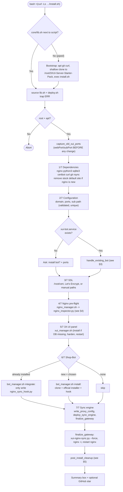
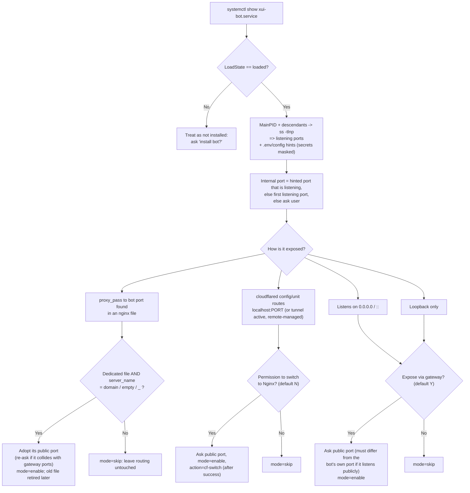
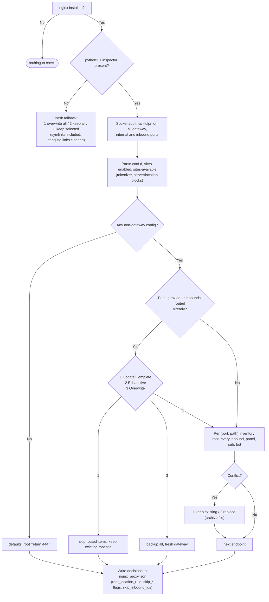
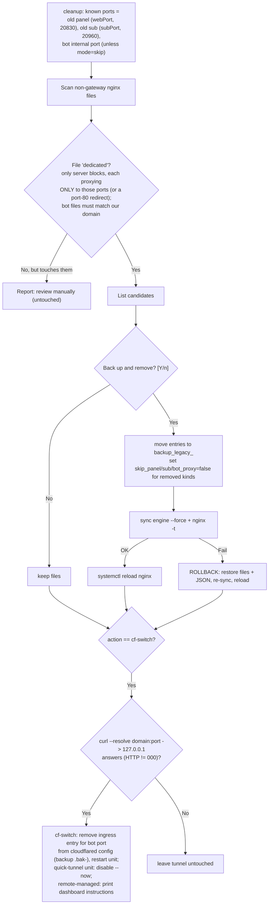
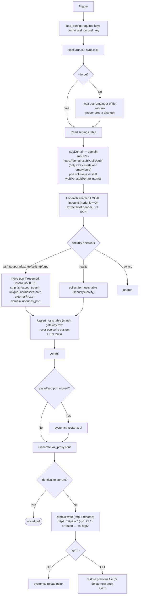

# 3XUI-Server-Starter-Pack: Complete Flow & Script Analysis

This document describes every script in the project, how they call each other, what state they read and write, and which safety nets exist. It reflects the current code (installer v2 / `xui-sync` 2.0).

---

## 1. Component Map

| File | Kind | Role | Runs when |
|---|---|---|---|
| `install.sh` | bash | Full installer / orchestrator (7 steps) | Once, by the user |
| `standalone-sync-setup.sh` | bash | Same flow for servers that already have 3X-UI (5 steps, no panel install) | Once, by the user |
| `core/lib.sh` | bash (sourced) | UI (banner, steps, boxes, spinner), validated prompts, `XUI_<VAR>` presets, `die` | Sourced by every script; copied to `/usr/local/lib/xui-starter-pack/lib.sh` for `xui-sync` |
| `core/deploy.sh` | bash (sourced) | Shared install steps: dependencies, config collection, existing-bot handling, SSL, config JSON, engine deployment, finalize, legacy cleanup | Sourced by both installers |
| `core/nginx_manager.sh` | bash | Pre-flight conflict resolver; delegates to the Python inspector, has a pure-bash fallback | Installer step "Nginx pre-flight" |
| `core/nginx_inspector.py` | python | Parses nginx configs, audits sockets, interactive conflict resolution, writes decisions into `nginx_proxy.json` | Called by `nginx_manager.sh`; also imported as a library |
| `core/xui_manager.sh` | bash | Installs 3X-UI if the DB is missing; WAL mode, `subDomain`, internal port shift, loopback binding, restart | Installer step "3X-UI panel" |
| `core/bot_manager.sh` | bash | Installs 3XUI-Shop-Bot (`install`) or only adds the sync hook to an existing one (`integrate`) | Installer step "Shop-Bot" |
| `core/legacy_cleanup.py` | python | `detect-bot`, `cleanup` (retire old nginx files), `cf-switch` (drop Cloudflare tunnel route) | Config phase and after success |
| `core/sync_engine.py` | python | Reads the 3X-UI DB, normalises inbounds/hosts/settings, generates `xui_proxy.conf`, validates and reloads nginx | Installed as `/usr/local/bin/xui-nginx-sync.py`; run by systemd and the CLI |
| `bin/xui-sync` | bash | User CLI: `status`, `doctor`, `hosts`, `config`, `sync`, `reload`, `log`, `version` | On demand |
| `systemd/xui-nginx-sync.path` | unit | Watches `x-ui.db` **and** `x-ui.db-wal` | Always (enabled) |
| `systemd/xui-nginx-sync.service` | unit | Oneshot: runs the sync engine | Triggered by the path unit |

### Persistent state

| Path | Written by | Content |
|---|---|---|
| `/etc/x-ui/nginx_proxy.json` (0600) | `write_proxy_config`, inspector, cleanup | Gateway configuration and user decisions (see §7) |
| `/etc/x-ui/x-ui.db` | x-ui, `xui_manager.sh`, sync engine | 3X-UI SQLite DB (WAL mode) |
| `/etc/nginx/conf.d/xui_proxy.conf` | sync engine only | Generated gateway config (never edit by hand) |
| `/etc/nginx/backup_<ts>/`, `backup_legacy_<ts>/` | inspector / cleanup | Archived original nginx files |
| `/var/log/xui-starter-pack.log` | `ui_run` | Output of noisy commands (apt, certbot, git clone) |
| `/run/xui-sync.lock` | sync engine | flock + timestamp of the last run (debounce) |
| `/usr/local/{bin,lib}/…` | `deploy_sync_engine` | Installed engine, CLI, shared lib |

---

## 2. Installer Flow (`install.sh`)

`standalone-sync-setup.sh` is identical except: no 3X-UI install (only `xui_manager.sh` configuration when the DB exists), no step for the bot installer, and the summary box differs.

### Step details

1. **Dependencies** (`install_dependencies`): records whether nginx was already installed (`NGINX_FRESH`). A freshly installed nginx ships `sites-enabled/default`; it is removed so it isn't reported as a user conflict.
2. **Configuration** (`collect_gateway_config`): validators `is_domain`, `is_port`; public ports for inbounds/panel/sub must be distinct; sub path normalised to `/x/`.
3. **SSL** (`configure_ssl`): prefers `/root/cert/<domain>/`, then `/etc/letsencrypt/live/<domain>/`. Certbot standalone stops nginx only if it was running and **always restarts it**, even on failure; otherwise asks for certificate paths.
4. **Nginx pre-flight**: see §4.
5. **3X-UI** (`xui_manager.sh`): installs only if `/etc/x-ui/x-ui.db` is missing; `PRAGMA journal_mode=WAL`; upserts `subDomain`; shifts `webPort`/`subPort` to `20830`/`20960` only if they equal the public ports; `webListen`/`subListen` = `127.0.0.1`; restarts x-ui.
6. **Shop-Bot**: new install or `integrate` (see §3).
7. **Engine** (`write_proxy_config` → `deploy_sync_engine` → `finalize_gateway`): values reach Python through environment variables (no code interpolation). `skip_bot_proxy` is derived from the bot mode (§3).

---

## 3. Existing Shop-Bot Detection (`legacy_cleanup.py detect-bot` + `handle_existing_bot`)

Effects of `BOT_PROXY_MODE`:

| Mode | `skip_bot_proxy` in JSON | Inspector bot port |
|---|---|---|
| `keep` (new bot or none) | previous/inspector value (True if no bot) | public port (or 0 if no bot) |
| `enable` | `false` | `0` (bot handled here, no duplicate conflict prompt) |
| `skip` | `true` | `0` |

An already-installed bot is **never reinstalled**; only `nginx_sync_hook.py` is (re)written inside its directory.

---

## 4. Nginx Pre-flight (`nginx_manager.sh` → `nginx_inspector.py`)

Safety details: archiving a file also removes symlinks left dangling in `sites-enabled` (otherwise `nginx -t` fails); a bot port of `0` never overwrites a stored bot port; with no controlling terminal, prompts use their defaults instead of blocking.

---

## 5. Post-Install Cleanup (`post_install_cleanup`)

Runs only after the gateway synced, `nginx -t` passed and nginx restarted.

A Cloudflare-routed bot keeps working until the gateway demonstrably serves it. The bot's own stored public URL (webhook/base URL) cannot be edited automatically; a reminder is printed.

---

## 6. Runtime: Sync Engine (`sync_engine.py`)

Triggered by `xui-nginx-sync.path` (any write to `x-ui.db` or `x-ui.db-wal`; in WAL mode most writes land in the `-wal` file) or by `xui-sync`.

Generated nginx structure:

- Port 80: ACME location + redirect to HTTPS.
- Inbounds port: `location /` per `root_location_rule` (default `return 444;`); one `location ^~ <path>` per non-skipped inbound (WebSocket/HTTPUpgrade headers, unbuffered streaming for xhttp, `grpc_pass` for gRPC).
- Panel port and subscription port: direct reverse proxy (no 302, so secret paths never leak), TLS upstream only if a cert is configured in x-ui.
- Bot port: only if `skip_bot_proxy` is false.

Important behaviours:

- Changing inbounds does **not** restart x-ui (to avoid dropping connections); only a moved panel/sub listener does, because otherwise nginx would return 502. After inbound edits, restart x-ui manually if Xray must pick them up.
- The engine is idempotent: a second run changes nothing (no flip-flop of `subPort`).
- Remote-node inbounds (`node_id > 0`) are never modified or routed.

---

## 7. Configuration File Schema (`/etc/x-ui/nginx_proxy.json`)

| Key | Meaning |
|---|---|
| `domain`, `ssl_cert`, `ssl_key` | Required |
| `inbounds_port`, `panel_public_port`, `sub_public_port`, `bot_public_port` | Public nginx listen ports |
| `panel_internal_port` (20830), `sub_internal_port` (20960), `bot_internal_port` | Loopback targets |
| `sub_path` | Default subscription path |
| `db_path`, `nginx_conf_path` | Locations |
| `root_location_rule` | Body of `location /` on the inbounds port |
| `skip_panel_proxy`, `skip_sub_proxy`, `skip_bot_proxy` | Don't generate that server block (kept/foreign rules) |
| `skip_inbound_ids` | Inbound IDs already routed elsewhere |

---

## 8. CLI (`xui-sync`)

| Command | Behaviour |
|---|---|
| *(none)* / `sync` / `run` | Run the engine with `--force` (needs root) |
| `status` | Service dashboard, endpoint URLs (honouring skip flags), listening ports |
| `doctor` | Checks: config JSON, domain, certificate readable/expiry (14-day warning), DB + WAL mode, services active, `nginx -t`, public ports listening; non-zero exit on failure |
| `hosts` | `hosts` table from the DB |
| `config` | Pretty-printed JSON config |
| `reload` | Sync, then `systemctl reload nginx` |
| `log` | `journalctl -u xui-nginx-sync.service -f` |

---

## 9. UX Layer (`lib.sh`)

- Capability detection: colour (TTY, `NO_COLOR`, `TERM`), UTF-8 (falls back to ASCII glyphs and a plain title).
- Primitives: `ui_banner`, `ui_step`, `ui_section`, `ui_box`, `ui_kv`, `ui_ok/info/warn/err/dim`, `ui_run` (spinner; command output goes to the log, and only that command's last lines are shown on failure).
- Prompts: `ask` (validator + retry), `confirm`, `choose`. All read from `/dev/tty`, so they work under `curl | bash`; with no terminal they use defaults or abort with a clear message instead of hanging.
- Unattended mode: pre-set `XUI_<VAR>` (e.g. `XUI_DOMAIN`, `XUI_INBOUNDS_PORT`, `XUI_HAS_BOT`, `XUI_ISSUE`, `XUI_NGINX_CHOICE`, `XUI_CF_SWITCH`, `XUI_EXPOSE`, `XUI_RETIRE_LEGACY`). An invalid preset aborts rather than silently falling back.

---

## 10. Safety Nets Summary

| Risk | Protection |
|---|---|
| Invalid generated nginx config | Atomic write, `nginx -t`, automatic restore of the previous file |
| Retiring old nginx files breaks the gateway | Files backed up first; config and files rolled back if validation fails |
| Cloudflare route removed before nginx works | Local probe through the gateway must answer first; config backed up |
| Certbot leaves nginx stopped | nginx restarted regardless of result |
| Lost updates during rapid DB writes | flock + wait-out debounce instead of skipping |
| WAL mode hides DB changes from the watcher | Path unit watches `x-ui.db-wal` too |
| Injection through prompts | No `eval`; values passed via environment / validated; SQL values escaped |
| Existing bot reinstalled or clobbered | Detection by systemd unit; `integrate` mode only writes the hook |
| Shared nginx files deleted | Only files made *solely* of recognised proxy blocks are retired; others are reported |

---

## 11. Known Limitations

- Inbound changes made by the engine need a manual `systemctl restart x-ui` to take effect in Xray.
- "Keep existing root rule" in the inspector archives the whole original file (it may contain other server blocks).
- Bot port and exposure detection relies on the process listening ports and common config keys; unusual setups (e.g. Docker with published ports) may fall back to asking for the port.
- Bot public URLs inside the bot's own configuration are not rewritten.
- Debian/Ubuntu (apt) only.
