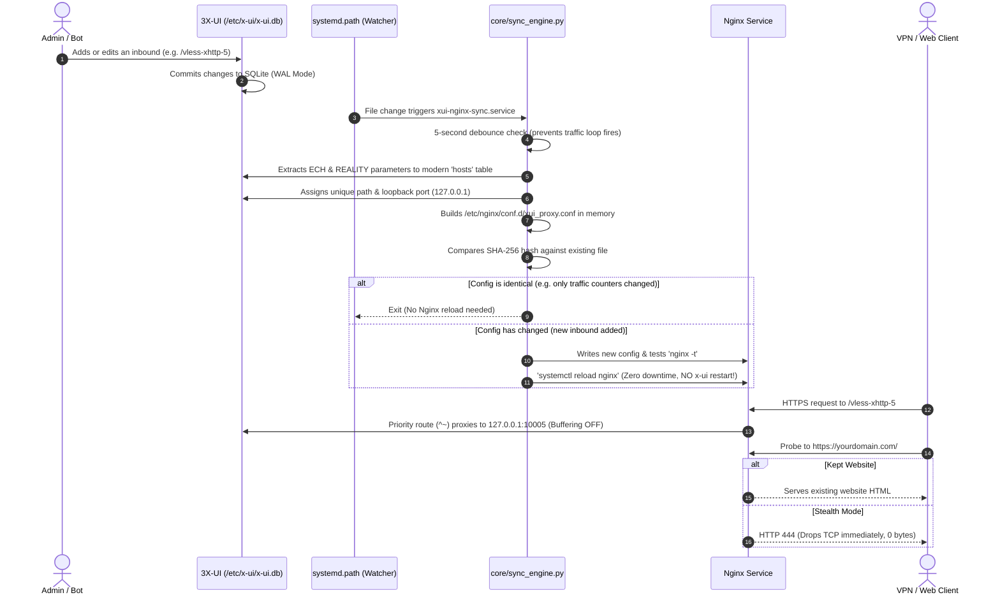

Here is the complete end-to-end flow of the script logic, covering initialization, inspection, conflict resolution, synchronization, and the ongoing background runtime loop.

---

### End-to-End Architecture Flowchart

```mermaid
flowchart TD
    Start(["User runs bash <(curl -Ls .../install.sh)"]) --> CheckEnv{"Executed via curl pipe?"}
    
    CheckEnv -- Yes (Missing ./core) --> Bootstrap["Self-Bootstrap:\nClone repo to /root/3XUI-Server-Starter-Pack\nexec bash install.sh"]
    CheckEnv -- No (Local directory) --> RootCheck{"Is Root (EUID==0)?"}
    Bootstrap --> RootCheck
    
    RootCheck -- No --> AbortFail["Abort: Must run as root"]
    RootCheck -- Yes --> InstallDeps["Install system packages:\nnginx, python3, sqlite3, certbot, curl, git"]
    
    InstallDeps --> GatherConfig["Gather Network Config:\nDomain, SSL cert/Let's Encrypt,\nPublic Ports (443, 2083, 2096, 8443)"]
    
    GatherConfig --> InspectNginx["core/nginx_inspector.py:\nScan /etc/nginx confs & /etc/x-ui/x-ui.db"]
    
    InspectNginx --> CheckPreConfig{"3X-UI + Nginx already\nintegrated together?"}
    
    CheckPreConfig -- "Yes (Panel / Inbounds found)" --> PromptMode{"User selects mode:"}
    PromptMode -- "1. Update / Complete" --> ModeComplete["Preserve working panel & inbounds;\nFlag missing inbounds & sub proxy for addition"]
    PromptMode -- "2. Conflict Resolver" --> ModeRuleByRule["Review (Domain, Port, Path) rule-by-rule"]
    PromptMode -- "3. Overwrite All" --> ModeOverwrite["Backup all to /etc/nginx/backup_<ts>/;\nFull clean replacement"]
    
    CheckPreConfig -- "No (Fresh or Unrelated)" --> CheckConflicts{"Port / Domain\nConflicts Exist?"}
    CheckConflicts -- Yes --> ModeRuleByRule
    CheckConflicts -- No --> ModeClean["Default clean settings:\nStealth 444 at root (/)"]
    
    ModeRuleByRule --> ResolveRoot["Conflict on (Domain, 443, '/'):\nKeep website at '/' OR Stealth 444?"]
    ResolveRoot --> ResolvePanel["Conflict on (Domain, 2083, panel):\nKeep existing config OR Gateway proxy?"]
    ResolvePanel --> ResolveSub["Conflict on (Domain, 2096, sub):\nKeep existing config OR Gateway proxy?"]
    
    ResolveSub --> SaveConfigJSON["Save decisions to /etc/x-ui/nginx_proxy.json:\n(root_location_rule, skip_panel, skip_sub, skip_inbound_ids)"]
    ModeComplete --> SaveConfigJSON
    ModeOverwrite --> SaveConfigJSON
    ModeClean --> SaveConfigJSON
    
    SaveConfigJSON --> ManageXUI["core/xui_manager.sh:\n1. Install 3X-UI if missing\n2. SQLite WAL mode (no lock freezes)\n3. Set subDomain & subPort in DB\n4. Shift internal ports (20830, 20960)\n5. Bind webListen & subListen to 127.0.0.1"]
    
    ManageXUI --> ManageBot{"Install 3XUI-Shop-Bot?\n(User Prompt y/N)"}
    ManageBot -- Yes --> BotInstall["Clone & run official install.sh;\nDeploy nginx_sync_hook.py"]
    ManageBot -- No --> DeployEngine["Deploy Sync Engine & Systemd Watcher"]
    BotInstall --> DeployEngine
    
    DeployEngine --> RunInitialSync["Run initial /usr/local/bin/xui-sync\n& enable xui-nginx-sync.path"]
    RunInitialSync --> PromptStar{"Support project with GitHub Star?\n(Prompt y/N)"}
    PromptStar -- Yes --> OpenBrowser["Launch browser / print clickable URL"]
    PromptStar -- No --> Done(["Installation Complete & Ready"])
    OpenBrowser --> Done
```

---

### Step-by-Step Execution Stages

#### 1. Self-Bootstrapping Stage (`install.sh` / `standalone-sync-setup.sh`)
* **Problem Solved**: When a multi-file project is piped via `bash <(curl ...)`, bash runs in `/dev/fd/63`, losing access to relative directories (`./core/`).
* **Logic**:
  1. Checks if `$SCRIPT_DIR/core` exists.
  2. If missing, it installs `git` and `curl`, clones `https://github.com/AliFanni-79/3XUI-Server-Starter-Pack.git` into `/root/3XUI-Server-Starter-Pack`, and hands off execution with `exec bash /root/3XUI-Server-Starter-Pack/install.sh "$@"`.
  3. Interactive terminal input (`stdin`) remains intact.

---

#### 2. Network & SSL Setup
* Asks for the public domain (e.g. `vpn.example.com`) and ports (default `443`, `2083`, `2096`, `8443`).
* Checks for certificates in `/root/cert/${DOMAIN}` or `/etc/letsencrypt/live/${DOMAIN}`.
* If no certificate is found, prompts to issue a free **Let's Encrypt certificate** via Certbot standalone.

---

#### 3. Pre-Configuration Inspection & Conflict Resolution (`core/nginx_inspector.py`)
This is the core intelligence module:
1. **Scans Existing Nginx Configs**: Parses every `.conf` file in `/etc/nginx/conf.d/` and `/etc/nginx/sites-enabled/` without breaking comments or strings.
2. **Scans 3X-UI Database (`/etc/x-ui/x-ui.db`)**: Reads `settings` (`webPort`, `subPort`, `webBasePath`) and all inbounds.
3. **Compares Integration State**:
   * **Update & Completion Mode**: If it detects that your panel or some inbounds are already working in Nginx, it asks to run in **Completion Mode**. It records which inbounds and panel rules are already working (`skip_inbound_ids`, `skip_panel_proxy`) so they are **never touched or redone**, and only routes missing inbounds or subscriptions.
   * **Rule-by-Rule Conflict Resolver**: If there is a clash on:
     * `(domain, 443, "/")`: Shows your existing website rule (e.g. WordPress, HTML) and asks whether to **Keep your website** (routing VPN paths alongside it) or use **Stealth Drop (`444`)**.
     * `(domain, 2083, panel)`: Lets you keep your existing panel config or replace it.
     * `(domain, 2096, sub)`: Lets you keep your existing subscription config or replace it.
4. **Saves Results**: Writes all decisions to `/etc/x-ui/nginx_proxy.json`.

---

#### 4. 3X-UI Hardening & Setup (`core/xui_manager.sh`)
1. Checks if 3X-UI is installed; if missing, runs MHSanaei's official installer.
2. **Enables SQLite WAL Mode (`PRAGMA journal_mode=WAL;`)**: Allows high-frequency traffic counter writes without database lock freezes.
3. **Reverse Proxy Subscription Injection**: Sets `subDomain` and `subPort` in the 3X-UI database so all client subscription links generated by 3X-UI or bots output `https://yourdomain.com:2096/sub/...`.
4. **Port Shifting**: Shifts internal panel and sub ports to `127.0.0.1:20830` and `127.0.0.1:20960` so Nginx can bind public ports `2083` and `2096` with SSL.

---

#### 5. Optional Bot Integration (`core/bot_manager.sh`)
* Asks if the user wants to install [3XUI-Shop-Bot](https://github.com/AliFanni-79/3XUI-Shop-Bot).
* If yes, clones and runs its official installer, and deploys `nginx_sync_hook.py`.

---

### Ongoing Runtime Loop (Post-Installation)

Once installed, the system operates completely autonomously in the background without human intervention:

---

### Key Safeguards Guaranteed by This Flow
1. **Zero 502 Downtime**: The sync script **never restarts `x-ui`** during background syncs.
2. **Zero 302 Redirect Leaks**: Bare visits to `:2083/` or `:2096/` do not return 302 redirects revealing secret panel paths.
3. **No Buffer Overflows on XHTTP**: `client_max_body_size 0;` and `proxy_request_buffering off;` allow unlimited streaming without RAM buildup.
4. **Non-Destructive**: Existing websites and prior panel setups are never silently overwritten.